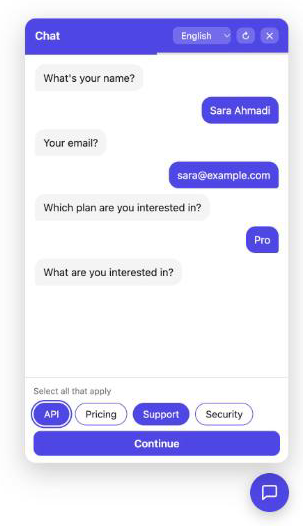
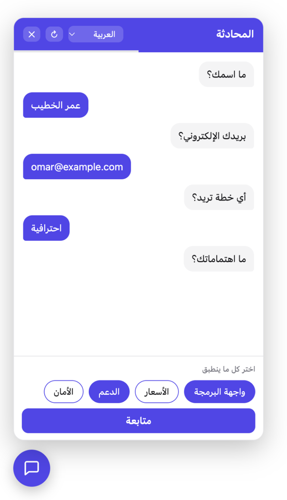

# StepChat

[](https://packagist.org/packages/faridm/stepchat)
[](https://github.com/faridmasoum/stepchat/actions)
[](https://packagist.org/packages/faridm/stepchat)
[](https://packagist.org/packages/faridm/stepchat)
[](LICENSE)

**Conversational forms that always finish, always validate, and never hallucinate your data.**

Build step-by-step chat experiences (lead capture, support triage, onboarding, quotes, surveys) in plain PHP. Your server owns the conversation: it decides the next question and validates every answer. An AI model is an *optional* helper for messy free text, never the source of truth. Add a polished chat widget to any website with **one `<script>` tag**.

<p align="center">
  
  &nbsp;&nbsp;
  
</p>

- [Why this instead of a normal chat service?](#why-this-instead-of-a-normal-chat-service)
- [Installation](#installation)
- [Quick start](#quick-start)
- [Add the chat widget to your website](#add-the-chat-widget-to-your-website)
- [Widget reference](#widget-reference)
- [Defining flows](#defining-flows)
- [Plugging in an AI model](#plugging-in-an-ai-model-optional)
- [Laravel](#laravel)
- [HTTP protocol](#http-protocol)
- [Testing](#testing) · [Contributing](#contributing) · [License](#license)

## Why this instead of a normal chat service?

Hosted chat tools and "just prompt an LLM" bots are great at open-ended conversation. They are a poor fit when you need a **specific set of validated answers** at the end of the conversation. This package is built for that job.

| | This package | Prompt-only LLM chatbot | Hosted chat SaaS (Intercom, Tidio, ...) |
|---|---|---|---|
| **Collected data is guaranteed valid** | Yes: every answer passes your rules before it is stored | No: the model may skip, invent or mis-format fields | Depends on the product's form blocks |
| **Always reaches the end** | Yes: the server picks the next step, so the flow cannot wander | No: conversations drift | Mostly |
| **Deterministic & unit-testable** | Yes: plain PHP, same input gives same output | No: output varies per run | No access to the logic |
| **Works with no AI at all** | Yes, and costs nothing per message | No | n/a |
| **AI cost** | Only when your rules cannot parse a message | Every message | Per seat / per conversation |
| **Your data stays on your server** | Yes: self-hosted, you own the storage | Sent to a model provider | Stored by the vendor |
| **Vendor lock-in** | None: MIT, any model or none | Provider specific | High |
| **Resume after reload / device hiccup** | Built in | You build it | Yes |
| **Safe against double-submit & stale tabs** | Built in (step mismatch protection) | You build it | Varies |
| **Edit an earlier answer** | Built in, with dependent steps re-opened | Awkward | Rare |
| **Multilingual with real RTL** | Built in: Arabic, Persian, Hebrew, Urdu, ... | Model dependent | Varies |
| **Front-end** | One script tag, no build step, no dependencies | You build it | Included (their branding) |

**The idea in one line: the engine decides, the AI assists.** Because the step-by-step logic never depends on a model call, a conversation that involves AI stays reproducible and testable.

## Installation

```bash
composer require faridm/stepchat
```

Requires PHP 8.0 or newer. There are no hard dependencies. The Laravel integration is used automatically when Laravel is present.

## Quick start

A complete flow in a handful of lines, using the built-in step presets:

```php
use FaridM\StepChat\Flow;
use FaridM\StepChat\FlowEngine;
use FaridM\StepChat\Steps;
use FaridM\StepChat\Support\ArraySession;
use FaridM\StepChat\Turn;

$flow = Flow::make()
    ->add(Steps::text('name', 'What is your name?'))
    ->add(Steps::email('email', 'And your email?'))
    ->add(Steps::choice('plan', 'Which plan?', ['starter' => 'Starter', 'pro' => 'Pro']))
    ->add(Steps::phone('phone', 'Phone number (optional)')->optional())
    ->onComplete(function (array $answers) {
        // $answers = ['name' => 'Farid', 'email' => '...', 'plan' => 'pro', 'phone' => null]
        // Save to your database, send an email, call your CRM...
    });

$engine  = new FlowEngine($flow);
$session = new ArraySession();
$engine->start($session);

$engine->ui($session);            // ['type' => 'text', 'message' => 'What is your name?', ...]

$engine->handleTurn($session, new Turn('name', Turn::TEXT, 'Farid'));
$result = $engine->handleTurn($session, new Turn('email', Turn::TEXT, 'nope'));
$result->isInvalid();             // true
$result->error;                   // "That does not look like an email address."

// ... answer the remaining steps, then:
$engine->ui($session);            // ['type' => 'review', 'items' => [...]]  summary screen
$engine->handleTurn($session, new Turn('done', Turn::SUBMIT))->isCompleted(); // true, onComplete fired
```

`ArraySession` can be saved anywhere via `toArray()` / `ArraySession::fromArray()` (cache, database, cookie).

## Add the chat widget to your website

The widget is optional. It is a single dependency-free JavaScript file (Shadow DOM, so your site's CSS cannot break it and it cannot break your CSS). Pick the path that matches your stack.

### Laravel: three steps

```bash
composer require faridm/stepchat
php artisan stepchat:install        # publishes config + script, scaffolds app/Chat/LeadFlow.php
```

1. Register the flow in `config/stepchat.php`:
   ```php
   'widget' => ['flows' => ['lead' => App\Chat\LeadFlow::class]],
   ```
2. Enable it in `.env`:
   ```
   STEPCHAT_WIDGET=true
   ```
3. Add one line to your layout, just before `</body>`:
   ```blade
   @stepChatWidget
   ```

Done. The route, caching of conversations, CSRF handling and the script tag are all taken care of. Options per call: `@stepChatWidget('lead', ['lang' => 'fa', 'color' => '#0ea5e9'])` or `<x-stepchat-widget flow="lead" lang="ar" />`.

Save the result by listening for the event:

```php
use FaridM\StepChat\Laravel\FlowCompleted;

Event::listen(FlowCompleted::class, fn ($e) => Lead::create($e->answers));
```

### Plain PHP (any framework or none)

`endpoint.php`: the entire backend:

```php
require __DIR__ . '/vendor/autoload.php';

use FaridM\StepChat\Flow;
use FaridM\StepChat\Http\ChatEndpoint;
use FaridM\StepChat\Http\FlowRegistry;
use FaridM\StepChat\Steps;
use FaridM\StepChat\Support\NativeSessionStore;

$flows = (new FlowRegistry())->register('lead', fn () => Flow::make()
    ->add(Steps::text('name', 'What is your name?'))
    ->add(Steps::email('email', 'Your email?'))
    ->onComplete(fn (array $answers) => mail('you@example.com', 'New lead', print_r($answers, true))));

(new ChatEndpoint($flows, new NativeSessionStore()))->serve();
```

Then on any page:

```html
<script src="/path/to/stepchat-widget.js"
        data-endpoint="/endpoint.php" data-flow="lead" defer></script>
```

A runnable version lives in [`examples/plain-php`](examples/plain-php): run `php -S localhost:8000` and open `/examples/plain-php/index.html`.

### Any site, via CDN

Copy the file from `resources/dist/stepchat-widget.js` or load it straight from GitHub through jsDelivr:

```html
<script src="https://cdn.jsdelivr.net/gh/faridmasoum/stepchat@v1.0.1/resources/dist/stepchat-widget.js"
        data-endpoint="https://your-api.example.com/chat" data-flow="lead" defer></script>
```

The endpoint can be anything that speaks the [HTTP protocol](#http-protocol) (for cross-origin use, send the usual CORS headers).

## Widget reference

### Script-tag attributes

| Attribute | Default | Description |
|---|---|---|
| `data-endpoint` | *required* | URL the widget POSTs to. |
| `data-flow` | `""` | Flow name, sent with every request. |
| `data-lang` | `auto` | Language code (`en`, `fa`, `ar`, `he`, `ur`, ...) or `auto` to use `<html lang>` / the browser language. |
| `data-dir` | `auto` | `ltr`, `rtl`, or `auto` (detected from the language). |
| `data-language-switcher` | off | Show a language dropdown in the header. |
| `data-languages` | all built-in | Comma list limiting the switcher, e.g. `en,fa,ar`. |
| `data-theme` | `auto` | `light`, `dark`, or `auto` (follows the visitor's OS). |
| `data-color` | `#4f46e5` | Brand colour. |
| `data-title` | translated | Header title. |
| `data-position` | `end` | `end` (bottom-right in LTR, bottom-left in RTL) or `start`. |
| `data-open` | `false` | Open the panel on load. |
| `data-mode` / `data-target` | floating | `data-mode="inline" data-target="#chat"` embeds the chat inside an element instead of a floating bubble. |

### JavaScript API

```html
<script src="stepchat-widget.js"></script>
<script>
  const chat = StepChatWidget.mount({
    endpoint: '/endpoint.php',
    flow: 'lead',
    lang: 'auto',
    languages: ['en', 'ar', 'fa'],          // enables the language switcher
    theme: 'auto',
    onComplete: (answers) => console.log(answers),
  });

  chat.open();  chat.close();
  chat.setLanguage('ar');   // switch at any time; the server re-localises the questions
  chat.restart();
  chat.destroy();
</script>
```

Events fire on the widget element and bubble to `document`: `acw:step` (`detail.step`, `detail.progress`) and `acw:complete` (`detail.summary`). Use them for analytics:

```js
document.addEventListener('acw:complete', (e) => gtag('event', 'lead', { flow: e.detail.flow }));
```

### Languages, RTL and switching

- **Built in:** English, Persian (fa), Arabic (ar), Hebrew (he), Urdu (ur), German, French, Spanish, Turkish.
- **Every right-to-left language is mirrored automatically** (Arabic, Persian, Hebrew, Urdu, Pashto, Sindhi, Kurdish (Sorani), Uyghur, Yiddish, Dhivehi and more): layout, bubbles, icons and the launcher position flip. Detection uses the browser's `Intl.Locale` with a built-in fallback list, and `data-dir` always wins if you need to override it.
- **Switch at runtime** with the dropdown (`data-language-switcher`) or `chat.setLanguage('fa')`. The widget sends the language to your server as `locale`, so your flow can return questions in that language too.
- **Add any language** (UI strings fall back to English for missing keys):

```js
StepChatWidget.addLocale('sv', {
  title: 'Chatt', send: 'Skicka', skip: 'Hoppa över', edit: 'Redigera',
  submit: 'Skicka in', placeholder: 'Skriv ditt svar…',
  done: 'Tack! Dina svar har skickats.',
}, { name: 'Svenska', dir: 'ltr' });

StepChatWidget.addLocale('ckb', { title: 'گفتوگۆ' }, { name: 'کوردی', dir: 'rtl' });
```

Localising the *questions* happens on your server, where you build the flow. The `$locale` argument is the language the visitor picked:

```php
$flows->register('lead', function (?string $locale): Flow {
    $q = $locale === 'fa' ? 'نام شما چیست؟' : 'What is your name?';
    return Flow::make()->add(Steps::text('name', $q));
});
```

### Theming

Override CSS custom properties from the page (they pierce the Shadow DOM boundary):

```css
[data-acw] { --acw-primary: #0ea5e9; --acw-radius: 12px; --acw-font: "Vazirmatn", system-ui; }
```

Available: `--acw-primary`, `--acw-on-primary`, `--acw-bg`, `--acw-fg`, `--acw-muted`, `--acw-border`, `--acw-bot`, `--acw-user`, `--acw-radius`, `--acw-font`, `--acw-z`.

### Built for real users

Keyboard navigation and focus management, `aria-live` announcements, `Escape` to close, reduced-motion support, full-screen layout on phones, dark mode, and text is always inserted as text (never HTML), so flow content cannot inject markup.

## Defining flows

### Step presets

| Preset | UI | Stores |
|---|---|---|
| `Steps::text($key, $label, $options)` | text / textarea (`multiline`), `min`, `max`, `pattern`, `placeholder` | string |
| `Steps::email($key, $label)` | email input | string |
| `Steps::phone($key, $label)` | tel input | string |
| `Steps::number($key, $label, $min, $max)` | number input | int / float |
| `Steps::choice($key, $label, $options)` | buttons | the chosen value |
| `Steps::multiChoice($key, $label, $options, $min, $max)` | multi-select | list of values |
| `Steps::confirm($key, $label)` | Yes / No | bool |

Every preset returns a `StepDefinition`, so you can chain `->optional()`, `->applies()`, `->invalidates()` and friends:

```php
Flow::make()
    ->add(Steps::choice('type', 'Are you a company?', ['yes' => 'Yes', 'no' => 'No']))
    ->add(Steps::text('company', 'Company name')
        ->applies(fn ($state) => $state->answer('type') === 'yes'))   // branching
    ->add(Steps::phone('phone', 'Phone')->optional(true, null));       // skippable
```

### Custom steps

For anything the presets don't cover, write your own rules. The engine never needs a model for this:

```php
use FaridM\StepChat\StepDefinition;
use FaridM\StepChat\StepResult;
use FaridM\StepChat\Turn;

StepDefinition::make('budget', 'What is your monthly budget (USD)?')
    ->ui(fn ($state) => ['type' => 'text', 'inputType' => 'number', 'min' => 100])
    ->parse(function (Turn $turn): StepResult {
        $n = (int) $turn->text();
        return $n >= 100 ? StepResult::ok($n) : StepResult::invalid('The minimum budget is 100 USD.');
    })
    ->display(fn ($value) => '$' . $value);   // how it appears on the review screen
```

### Branching, editing, interrupts

- **Branching:** `->applies(fn (ChatState $s) => ...)` decides whether a step is asked at all.
- **Editing:** the review screen lets users change any earlier answer. If `->invalidates(['city'])` is set on that step and the answer changes, the dependent steps are cleared and re-asked.
- **Interrupts:** pause for a side question and resume afterwards: `$state->startInterrupt('confirm_phone', $session->currentStep())`.
- **Errors you can catch:** `StepMismatchException` (stale tab or replayed request) and `InvalidTurnException` (unknown step). The HTTP layer already turns them into proper responses.

### UI payload

`FlowEngine::ui($session)` returns what a client should render. The bundled widget renders all of these; you can render them yourself in any front-end:

| `type` | Fields |
|---|---|
| `text` | `message`, `inputType` (`text`/`email`/`tel`/`number`), `placeholder`, `maxLength`, `optional` |
| `textarea` | same as `text` |
| `choice` | `message`, `options: [{value, label}]`, `optional` |
| `multi` | `message`, `options`, `min`, `max` |
| `review` | `items: [{step, label, value}]`: send a `submit` turn, or `edit` turns |
| `done` | the flow is finished |

## Plugging in an AI model (optional)

Implement one interface to let a model interpret free text **only** where your deterministic rules return `StepResult::unrecognised()` (as opposed to `invalid()`):

```php
use FaridM\StepChat\ChatState;
use FaridM\StepChat\Contracts\TurnInterpreter;
use FaridM\StepChat\Interpretation;

final class LlmInterpreter implements TurnInterpreter
{
    public function interpret(ChatState $state, string $step, string $text): Interpretation
    {
        // Call any provider you like with plain HTTP, map the reply onto the step.
        $value = my_llm_extract($step, $text);   // e.g. "next Friday, around 3pm" -> "2026-11-13T15:00"

        return $value !== null ? Interpretation::ok($value) : Interpretation::fail();
    }
}

$engine = new FlowEngine($flow, new LlmInterpreter());
// or with the widget: new ChatEndpoint($flows, $store, new LlmInterpreter())
```

Guarantees that keep it safe:

- The interpreter is consulted only on free-text turns that your own parser could not classify.
- It never overrides a successful deterministic parse and never chooses the next step.
- `Interpretation::ok($value, ['other_step' => 'value'])` can also fill other steps answered in the same message.
- Without an interpreter the package makes zero network calls and costs nothing to run.

## Laravel

Everything is opt-in; the package works in Laravel 8 to 12 through auto-discovery.

```bash
php artisan vendor:publish --tag=stepchat-config   # config/stepchat.php
php artisan vendor:publish --tag=stepchat-assets   # public/vendor/stepchat/stepchat-widget.js
php artisan stepchat:install                                      # both of the above + a sample flow
```

Without publishing the assets, `@stepChatWidget` loads the script from the jsDelivr CDN. Conversations are stored in your cache (`cache_store`, `session_ttl` in the config), so they survive page reloads on any cache driver.

### Persisting conversations in your database

To keep sessions in Eloquent instead (for your own back-office, analytics or hand-over to a human), use the trait:

```php
use FaridM\StepChat\Laravel\HasChatState;

class ChatSession extends Model
{
    use HasChatState;

    protected $casts = ['chat_state' => 'array', 'completed_at' => 'datetime'];
}
```

```php
Schema::create('chat_sessions', function (Blueprint $table) {
    $table->id();
    $table->string('current_step');
    $table->json('chat_state')->nullable();
    $table->unsignedInteger('turn_count')->default(0);
    $table->timestamp('completed_at')->nullable();
    $table->timestamps();
});
```

The model then satisfies `Contracts\ChatSession` and can be passed straight into `FlowEngine`.

## HTTP protocol

The widget and `ChatEndpoint` speak a tiny JSON protocol, so you can also build your own client (React Native, Flutter, ...).

`POST` JSON to the endpoint:

```json
{ "flow": "lead", "locale": "ar", "session": "<id or null>", "action": "turn",
  "turn": { "step": "email", "type": "text", "value": "a@b.com" } }
```

| `action` | Meaning |
|---|---|
| `start` | Begin, or resume if `session` is known. |
| `state` | Current state (used after a language change). |
| `restart` | Throw the session away and begin again. |
| `turn` | Send an answer. `turn.type`: `text`, `choice`, `list`, `skip`, `edit`, `submit`. |

Response:

```json
{ "session": "…", "status": "continue | invalid | completed", "step": "plan",
  "ui": { "type": "choice", "message": "Which plan?", "options": [{ "value": "pro", "label": "Pro" }] },
  "progress": { "current": 3, "total": 5 },
  "summary": [{ "step": "name", "label": "What is your name?", "value": "Farid" }],
  "error": null }
```

HTTP codes: `200` ok (including validation errors, in `status`/`error`), `400` malformed request, `404` unknown flow, `409` stale client (the body carries the current state to re-sync).

Session ids are 128-bit random values stored server-side; the browser keeps its id in `localStorage` so a reload continues where the visitor left off.

## Testing

```bash
composer install
composer test        # PHPUnit
composer analyse     # PHPStan level 6
composer format      # PHP-CS-Fixer
```

Because flows are plain PHP, you can unit-test an entire conversation with `ArraySession` and no mocks:

```php
public function test_rejects_a_bad_email(): void
{
    $engine = new FlowEngine(Flow::make()->add(Steps::email('email', 'Your email?')));
    $session = new ArraySession();
    $engine->start($session);

    $result = $engine->handleTurn($session, new Turn('email', Turn::TEXT, 'bad'));

    $this->assertTrue($result->isInvalid());
    $this->assertSame('email', $session->currentStep());   // did not advance
}
```

## Contributing

Issues and pull requests are welcome; see [CONTRIBUTING.md](CONTRIBUTING.md). Please report security issues privately as described in [SECURITY.md](SECURITY.md). Release notes are in [CHANGELOG.md](CHANGELOG.md).

## License

MIT © Farid Masoum. See [LICENSE](LICENSE).
